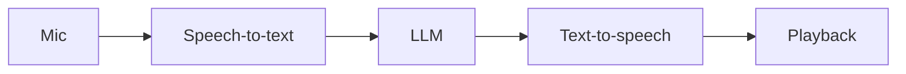

 

I build AI systems that run outside a notebook: multi-agent workflows, voice agents, retrieval pipelines and LLM products. I care about **measured** engineering — load-tested inference, honest evals, and keeping every wrong prediction on the record.

 

### What I work on

<table>
<tr>
<td width="33%" valign="top">

**🎙️ Voice & agents**

Real-time voice agents: speech-to-text → LLM → neural text-to-speech.

Multi-agent workflows with tools, memory and reasoning.

</td>
<td width="33%" valign="top">

**🔎 Retrieval**

Hybrid search with reranking.

Answers that cite their sources and decline when they are unsure.

</td>
<td width="33%" valign="top">

**⚡ Inference & media**

LLM serving on small GPUs, load-tested.

Image, video and voice generation pipelines.

</td>
</tr>
</table>

### Stack

### Now building

Voice agents that hold a real conversation with low latency.

 

