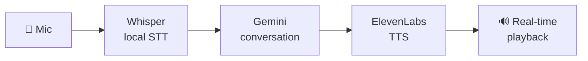

<!-- NOTE: the Voice-Agent repo currently lives under the justkuldeep account. Update its links below if you move/fork it to DamnKuldeep. -->

 

---

### 👋 About

I build **multi-agent systems**, **voice agents**, **RAG pipelines**, and **LLM-powered products** that go from idea to something actually running — not just a notebook. Lately I care about **measured** engineering: load-tested inference, honest evals, and keeping every wrong prediction on the record.

<table>
<tr>
<td width="50%" valign="top">

**🔭 Working on**
- Real-time **voice agents** (local STT → LLM → neural TTS)
- Serving LLMs on **constrained hardware**
- Agent ensembles that *don't* trust a single model
- Fully unattended generative media pipelines

</td>
<td width="50%" valign="top">

**⚡ What I build**
- Multi-agent workflows with tools, memory & reasoning
- Retrieval + reranking for grounded, cited answers
- Inference gateways with admission control & observability
- Image / video / voice generation pipelines

</td>
</tr>
</table>

---

### 🚀 Featured projects

<table>
<tr>
<td width="50%" valign="top">

#### 🎙️ [Voice-Agent](https://github.com/justkuldeep/Voice-Agent)
**A complete AI voice call pipeline, built step by step.**
Local **Whisper** speech-to-text → **Gemini** for conversation → **ElevenLabs** for voice, with real-time audio playback. Modular design with documentation and troubleshooting guides.

`Whisper` `Gemini` `ElevenLabs` `Python` `Real-time audio`

</td>
<td width="50%" valign="top">

#### ⚡ [qwen2.5-1.5b-awq-vllm-rtx3050-4gb](https://github.com/DamnKuldeep/qwen2.5-1.5b-awq-vllm-rtx3050-4gb)
**20 concurrent chat users from one 4 GiB laptop GPU.**
**97%** of messages get a first token within **1.5 s** (retries included). Cache-aware admission control, a head-of-line fix, 10 predictive alerts, a 14-case failure matrix, and 24 predictions kept on record.

`vLLM` `AWQ + Marlin` `FastAPI` `Prometheus` `Grafana`

</td>
</tr>
<tr>
<td width="50%" valign="top">

#### ⚖️ [KnowYourRightsAI](https://github.com/DamnKuldeep/KnowYourRightsAI)
**Indian-law answers in English, Hindi & Hinglish — every claim traced to an Act and section.**
**38,890** chunks across **1,020** Acts, **98%** recall@5, calibrated to decline rather than hallucinate. Reads government portals for procedure questions.

`FastAPI` `LanceDB` `bge-m3 + BM25` `Cross-encoder rerank` `NVIDIA NIM`

</td>
<td width="50%" valign="top">

#### 🎬 [ContentFactory](https://github.com/DamnKuldeep/ContentFactory)
**One story idea → a finished 1080×1920 vertical video, fully unattended.**
Script, narration with per-character timing, 30+ consistent scene images, music built from the voice's energy, and the cut. **88 videos** in one batch on 3 machines, ~25 min each.

`Llama 3.3 70B` `FLUX.2` `Fish Speech` `WhisperX` `FFmpeg`

</td>
</tr>
<tr>
<td colspan="2" valign="top">

#### 🎞️ [ltxv-13b-distilled-free-gpu-pipeline](https://github.com/DamnKuldeep/ltxv-13b-distilled-free-gpu-pipeline)
**A 13B text/image-to-video model on free Kaggle T4 GPUs.**
NF4 quantization shrinks ~26 GB of weights to ~8.5 GB, dual-GPU memory splitting, 22 hot-swappable LoRA styles, and LLM prompt enhancement.

`LTX-Video` `NF4` `PEFT / LoRA` `Gradio` `Kaggle`

</td>
</tr>
</table>

#### 🎙️ How the voice agent works

---

### 🧠 Tech stack

---

### 📊 GitHub stats

---

### 🔥 Currently exploring

> Building AI experiences that are not just interesting, but **useful, deployable, and engineered for scale.**

`Voice agents` · `Agentic execution systems` · `Grounded retrieval & memory` · `Performance-first inference` · `LLM-native products`

---

